# Docker arxitekturasi — daftar konspekti

O'zbek tilida, qo'lda yozilgan daftar uslubidagi Docker konspekti: Docker nima, qanday ishlaydi, arxitekturasi, konteynerning ichki tuzilishi va barcha imkoniyatlari.

- `rasmlar/` — har bir varaq alohida PNG rasm
- `index.html` — interaktiv versiya (brauzerda oching; testdagi javoblar bosilganda ochiladi)

## Mundarija

- [Muqova va mundarija](#muqova)
1. [Docker — bu nima?](#1-varaq)
2. [Docker qanday ishlaydi?](#2-varaq)
3. [Docker arxitekturasi](#3-varaq)
4. [Konteyner anatomiyasi](#4-varaq)
5. [Image ichki tuzilishi (OCI)](#5-varaq)
6. [Diskdagi tuzilma: overlay2](#6-varaq)
7. [Namespaces batafsil](#7-varaq)
8. [cgroups batafsil](#8-varaq)
9. [Konteyner tarmog'i ichidan](#9-varaq)
10. [PID 1 va signallar](#10-varaq)
11. [Holatlar, exit kodlar, restart](#11-varaq)
12. [Xavfsizlik qatlamlari](#12-varaq)
13. [Amaliyot: konteynerni ochib ko'ramiz](#13-varaq)
14. [Docker'ning barcha imkoniyatlari](#14-varaq)
15. [Imkoniyatlar (davomi) va shpargalka](#15-varaq)
16. [Yaxshi amaliyotlar va xatolar](#16-varaq)
17. [O'zingni tekshir](#17-varaq)
18. [Lug'at](#18-varaq)

## Muqova

**Muqova va mundarija**

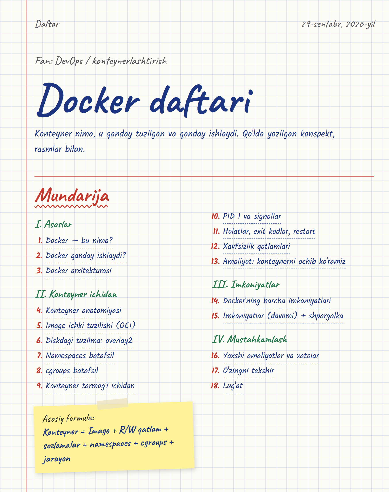

## 1-varaq

**Docker — bu nima?**

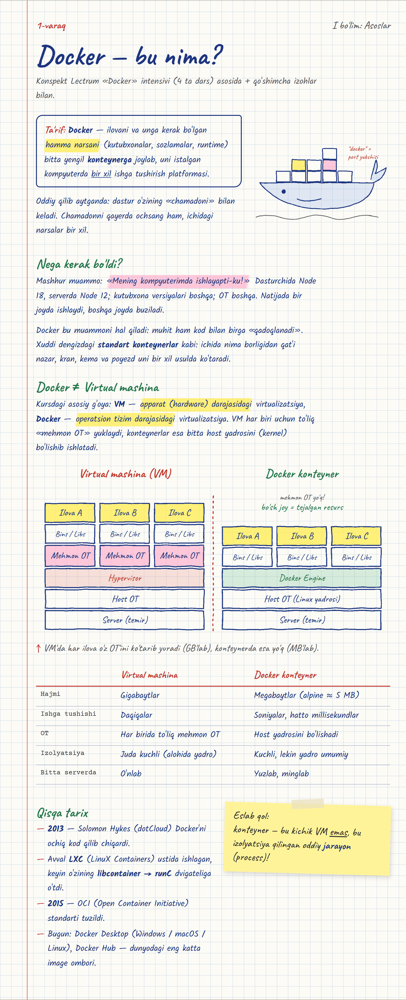

## 2-varaq

**Docker qanday ishlaydi?**

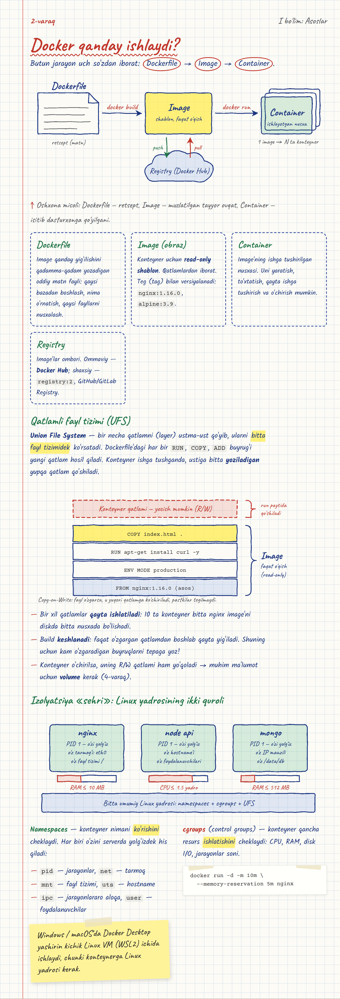

## 3-varaq

**Docker arxitekturasi**

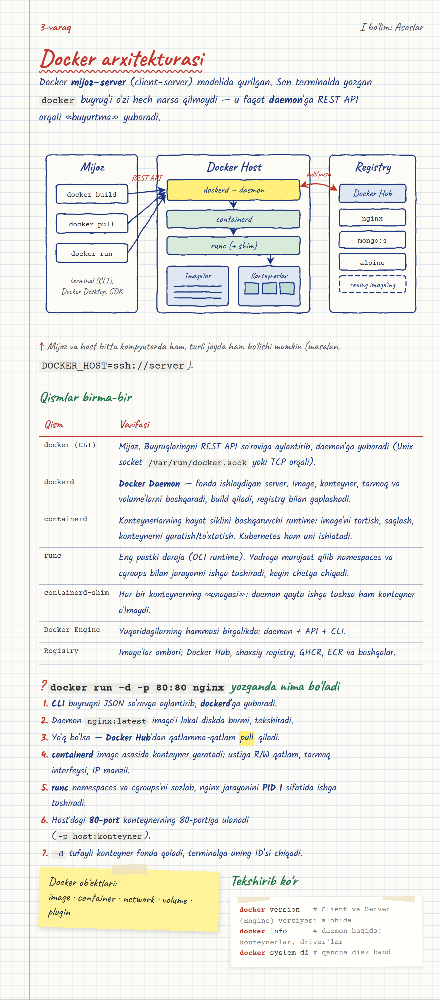

## 4-varaq

**Konteyner anatomiyasi**

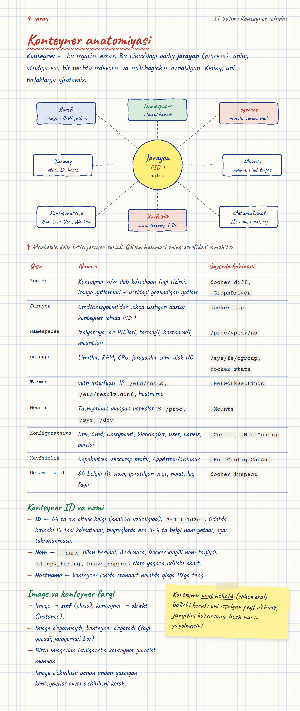

## 5-varaq

**Image ichki tuzilishi (OCI)**

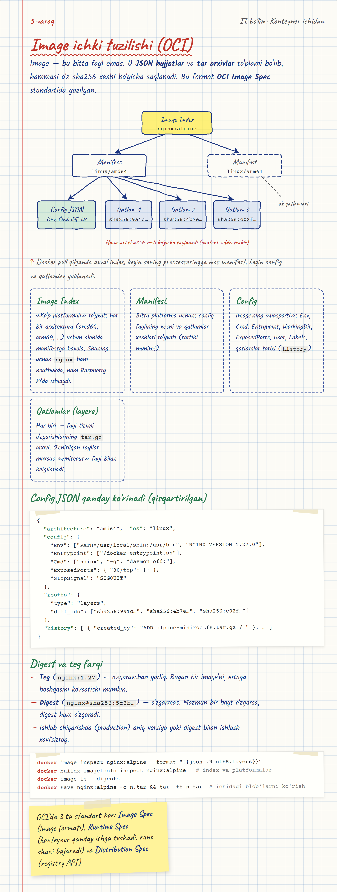

## 6-varaq

**Diskdagi tuzilma: overlay2**

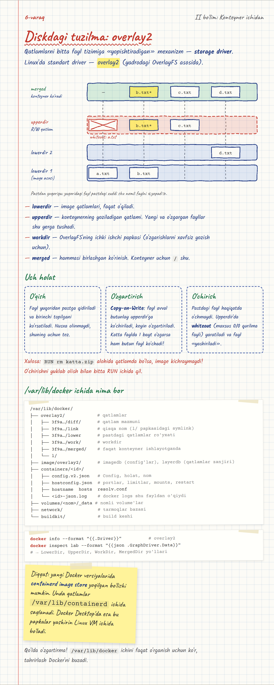

## 7-varaq

**Namespaces batafsil**

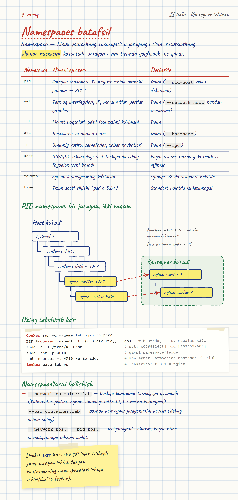

## 8-varaq

**cgroups batafsil**

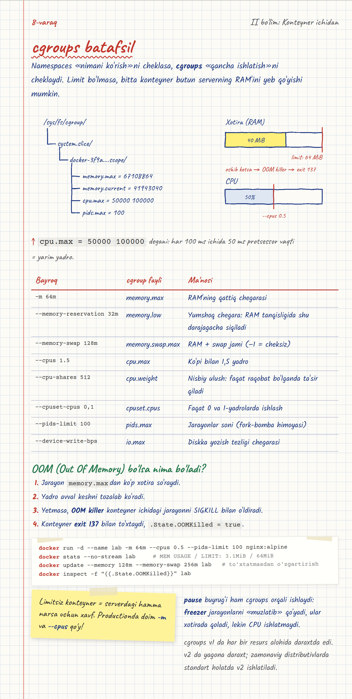

## 9-varaq

**Konteyner tarmog'i ichidan**

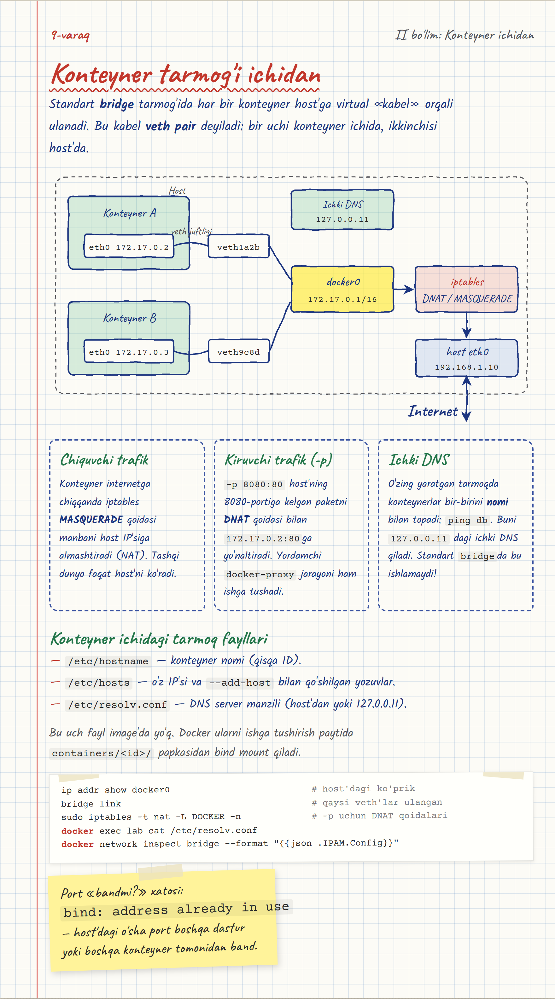

## 10-varaq

**PID 1 va signallar**

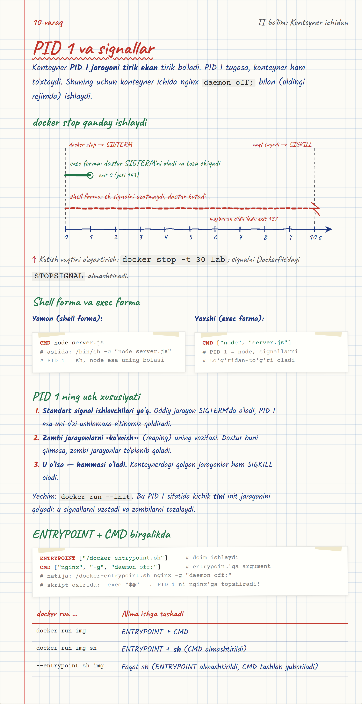

## 11-varaq

**Holatlar, exit kodlar, restart**

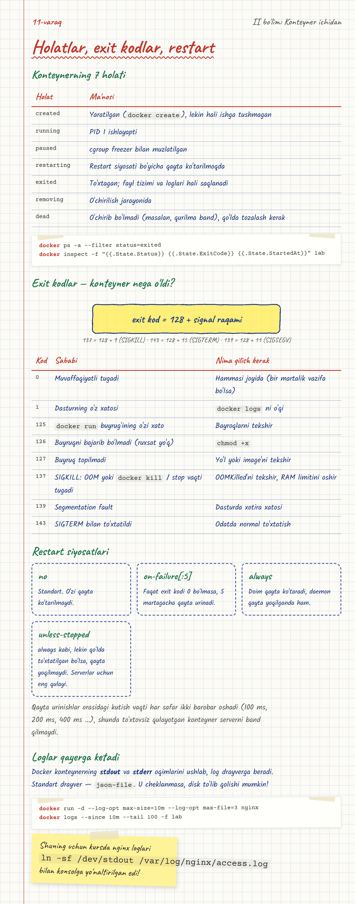

## 12-varaq

**Xavfsizlik qatlamlari**

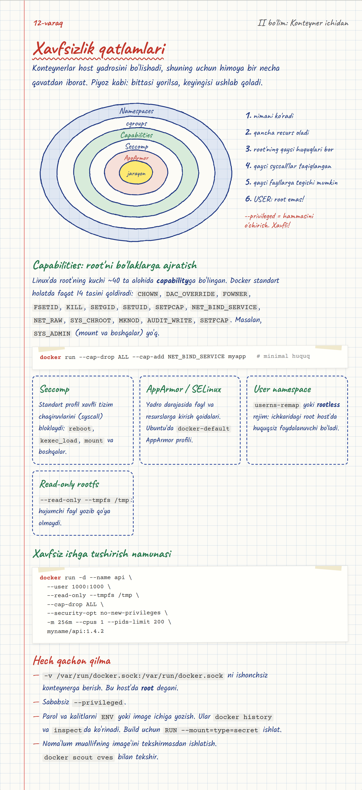

## 13-varaq

**Amaliyot: konteynerni ochib ko'ramiz**

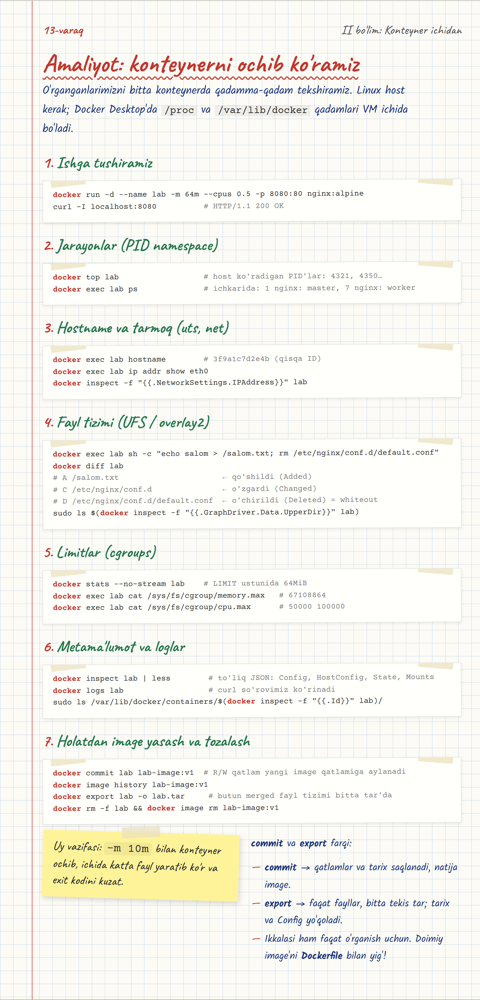

## 14-varaq

**Docker'ning barcha imkoniyatlari**

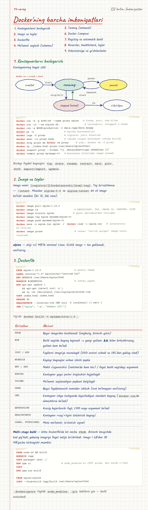

## 15-varaq

**Imkoniyatlar (davomi) va shpargalka**

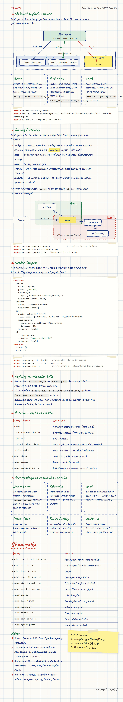

## 16-varaq

**Yaxshi amaliyotlar va xatolar**

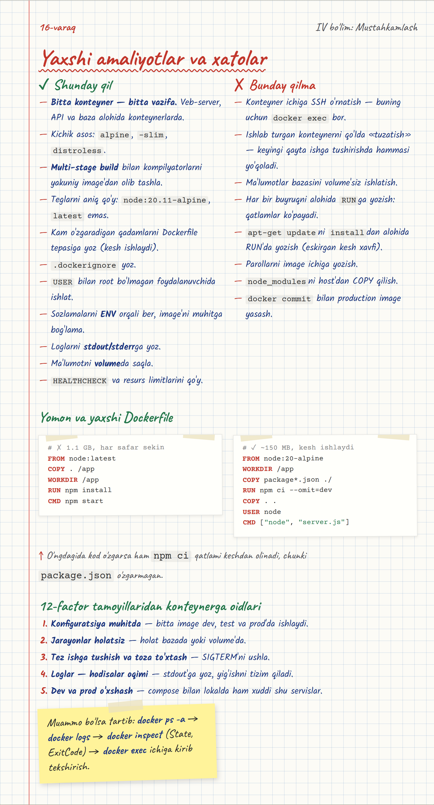

## 17-varaq

**O'zingni tekshir**

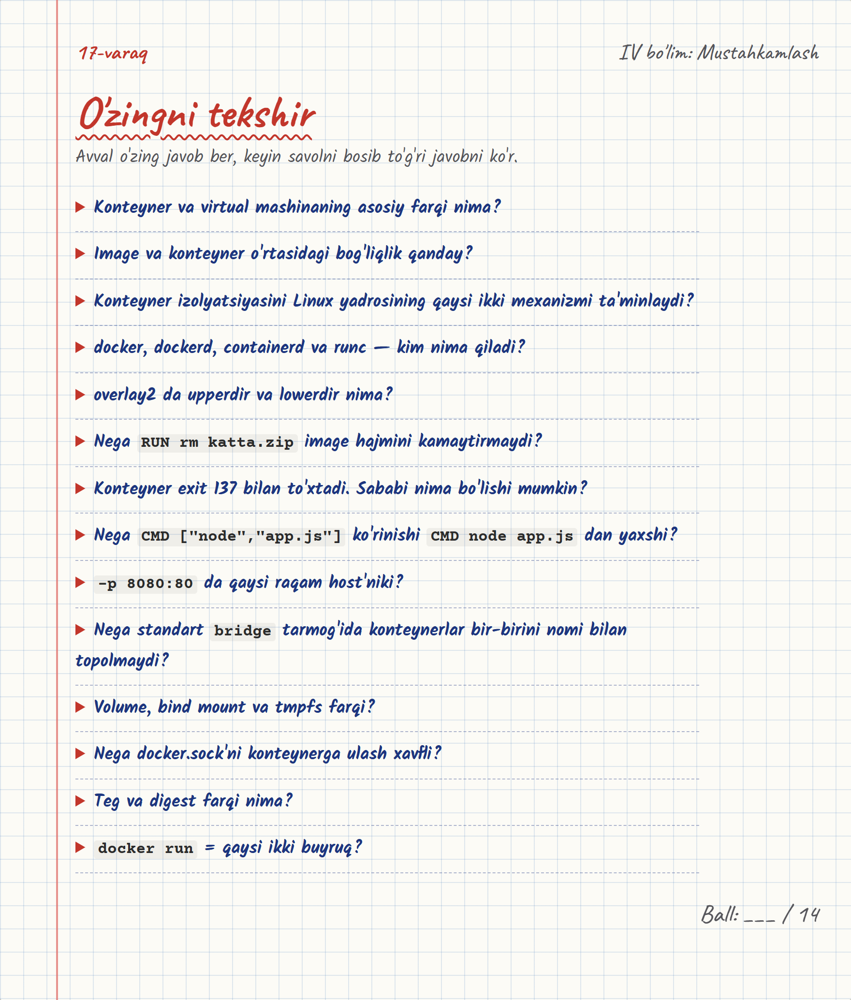

## 18-varaq

**Lug'at**

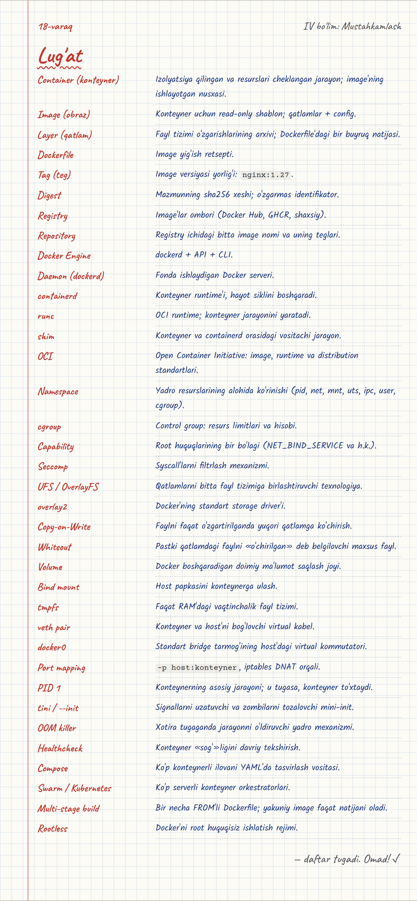
